# Live Architecture: How the MPC Runs on FSDS

Every node, topic and launch file that runs when the MPC drives the simulated car, as Mermaid flowcharts. Four views, increasing in detail:

1. [High-level pipeline](#1-high-level-pipeline-five-jobs-two-switches): the five jobs and the two switches that change the wiring.
2. [Node and topic graph](#2-node-and-topic-graph-the-real-wiring): the real ROS 2 wiring, with an exhaustive [connection table](#connection-table-every-topic-verified-from-source).
3. [Launch tree](#3-launch-tree-what-launch_allsh-starts): what `ros2/launch_all.sh` and each launch file start.
4. [Inside each node](#4-inside-each-node-one-flowchart-per-module): one flowchart per module, in the order data flows through them.

Scope and neighbours:

- This is the live (FSDS) side, code in `ros2/src/fsae_planning/` (mirrored at `fsds_simulator/`). The offline simulator's loop is in [reference/architecture.md](../reference/architecture.md).
- Where FSDS, the bridge and WSL run is in [ros_integration.md](ros_integration.md). Build and run steps are in [integration_guide.md](integration_guide.md).
- File-by-file detail is in [modules/fsds_ros2.md](../modules/fsds_ros2.md). The solver maths is in [lmpc.md](../controllers/lmpc.md) and [nmpc.md](../controllers/nmpc.md).

Each chart is shown as an SVG from `docs/diagrams/`, with its Mermaid source in a collapsed block underneath. Edit the source, then re-render with `python3 -m tuner.tools.render_diagrams` (see [diagrams/README.md](../diagrams/README.md)).

The diagrams were built from the source: every `create_publisher` and `create_subscription` in the workspace, the launch files and `ros2/launch_all.sh`. The running graph is ground truth: check it with `ros2 node list`, `ros2 node info /controller` and `rqt_graph`. When a diagram and the table disagree, the table is the one to fix first.

**Glossary for this page.**

- **Node:** one running ROS 2 process with a name, for example `sim_perception`.
- **Topic:** a named channel. A node publishes messages on it and any number of nodes subscribe.
- **Latched (`TRANSIENT_LOCAL`):** the last message is kept and handed to a subscriber that connects later.
- **Tick:** one run of a node's fixed-rate timer. The controller ticks at 20 Hz, every 0.05 s.

---

## 1. High-level pipeline: five jobs, two switches

**Plain version.** The simulator knows exactly where the car and every cone are. A stand-in for perception hides the cones the car could not yet see. A planner turns visible cones into a centre line. The MPC turns the line and the car's state into throttle, brake and steering. The bridge hands that command back to the simulator. By default the planner is skipped and the controller follows a line and speed profile precomputed for the track.


Mermaid source (edit this, then run <code>python3 -m tuner.tools.render_diagrams</code>)

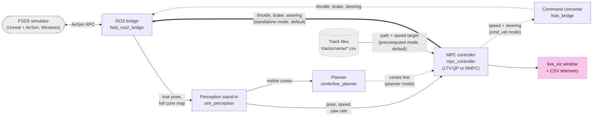

Two independent switches change the wiring. Both are launch arguments and both are set at the top of `ros2/launch_all.sh`.

| switch | default | `true` | `false` |
|---|---|---|---|
| `use_precomputed_path` (`USE_PRECOMPUTED_PATH`) | `true` | Controller reads the path CSV at startup. The planner is not launched. | `centerline_planner` runs and publishes the path every pose update. |
| `standalone_output` (`STANDALONE_OUTPUT`) | `true` | Controller publishes throttle, brake and steering straight to the bridge, and owns GO gating and cone braking. `fsds_bridge` is not launched. | Controller publishes only speed and steering on `cmd_vel`. `fsds_bridge` turns speed into throttle and brake with its own P-loop and owns GO gating and cone braking. |

- `use_precomputed_speed` is a third, related switch: speed target from `speed_profile.csv` (default) or from the curvature of the live path.
- The standalone mode is the one that matches the offline tuner, because only it keeps the MPC's own acceleration command. The `cmd_vel` mode discards it.
- Which solver runs inside `mpc_controller` is a separate choice, `use_nmpc`. The dataclass default is `false`, but `launch_all.sh` sets `USE_NMPC=true`, so a normal run uses the NMPC.

---

## 2. Node and topic graph: the real wiring

**Reading it.** Boxes are nodes, with the ROS package as the group. Arrows are topics, labelled `topic · message type`. Thick arrows are the default command path. Dashed arrows and dashed boxes only exist under a non-default launch argument, named in the label. Exactly one planner and one controller run at a time, and both controllers use the ROS node name `controller`.


Mermaid source (edit this, then run <code>python3 -m tuner.tools.render_diagrams</code>)

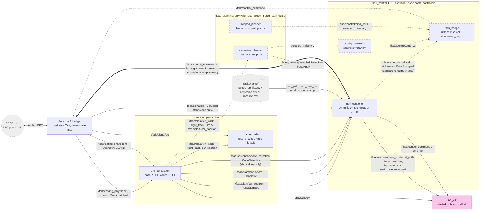

Not drawn, to keep the graph readable (all are in the table):

- The raw-odometry and GO inputs of Stanley, `fsds_bridge` and `skidpad_planner`.
- The temporary topic-rate diagnostics and `clock_drift_check.py` (they only subscribe).
- `brake_sysid`, which replaces the whole stack when `RUN_BRAKE_SYSID=true`.

### Connection table: every topic, verified from source

| Topic | Type | Carries | Publisher(s) | Subscriber(s) | Notes |
|---|---|---|---|---|---|
| `/fsds/testing_only/odom` | `nav_msgs/Odometry` | Ground-truth pose and body-frame twist of the car. | `fsds_ros2_bridge` (250 Hz) | `sim_perception`, `stanley_controller`, `fsds_bridge`, `skidpad_planner`, `brake_sysid`, diagnostics | `mpc_controller` deliberately does not read it, see `car_odom`. Subject to the periodic transport stall, see [quirk 7](#quirks-the-diagrams-encode). |
| `/fsds/testing_only/track` | `fs_msgs/Track` | Every cone on the track, with colour. | `fsds_ros2_bridge` (latched) | `sim_perception` | Oracle data. Nothing on the real car has it. |
| `/fsds/signal/go` | `fs_msgs/GoSignal` | Race start. | `fsds_ros2_bridge` | `mpc_controller` (standalone only), `fsds_bridge`, `cone_recorder`, `brake_sysid` | Before GO the command source holds full brake. |
| `/fsds/control_command` | `fs_msgs/ControlCommand` | Throttle `[0,1]`, brake `[0,1]`, steering `[-1,1]` (+1 = right). | `mpc_controller` (standalone) **or** `fsds_bridge` **or** `brake_sysid` | `fsds_ros2_bridge`, `live_viz` | **No mux.** Exactly one publisher must run. `control.launch.py` skips `fsds_bridge` in standalone mode for this reason. |
| `/fsds/imu`, `/clock` | `sensor_msgs/Imu`, `rosgraph_msgs/Clock` | Simulated IMU, simulation clock. | `fsds_ros2_bridge` | Diagnostics only | No control node reads them. |
| `/fsae/slam/car_position` | `geometry_msgs/PoseStamped` | `x, y` in `position`, **yaw in radians in `orientation.w`** (not a real quaternion). Stamp is the odometry's own measurement time. | `sim_perception` (20 Hz) | `mpc_controller`, `stanley_controller`, `centerline_planner`, `skidpad_planner`, `cone_recorder`, `live_viz` | The planner and Stanley run one step per message. `mpc_controller` uses the stamp to measure `pose_age_s`. |
| `/fsae/slam/car_odom` | `nav_msgs/Odometry` | The same snapshot as `car_position`: pose (real quaternion) plus `v_x`, `v_y` and yaw rate. | `sim_perception` (20 Hz, published back to back with `car_position`) | `mpc_controller`, `live_viz` | `mpc_controller` takes speed, `v_y` and yaw rate from here and position and yaw from `car_position`. `sim_perception` publishes both back to back from one odometry sample, so normally the solver's state comes from one instant. They are still two subscriptions, so a tick between the two deliveries, or a dropped best-effort `car_odom` message, can pair a new pose with the previous twist. |
| `/fsae/slam/left_track` | `fsae_interfaces/Track` | Visible blue (left) cones, global frame. | `sim_perception` (10 Hz) | `centerline_planner`, `skidpad_planner`, `cone_recorder`, `live_viz` | Cropped to what the car could see, see [4.1](#41-sim_perception-hides-the-cones-the-car-could-not-yet-see). |
| `/fsae/slam/right_track` | `fsae_interfaces/Track` | Visible yellow (right) cones, global frame. | `sim_perception` (10 Hz) | as above | |
| `/fsae/perception/cone_detection` | `fsae_interfaces/ConeDetection` | Visible cones in the **car's** frame, plus the car pose. | `sim_perception` (10 Hz) | `mpc_controller` (standalone only), `fsds_bridge` | Input to the cone-proximity brake only. |
| `/fsae/planning/selected_trajectory` | `geometry_msgs/PoseArray` | The centre line to follow, positions only. | `centerline_planner` **or** `skidpad_planner` | `mpc_controller`, `stanley_controller`, `live_viz` | **Nothing publishes it in the default precomputed-path mode.** The controller then ignores the topic and uses its CSV path. It brakes if a live path is older than `PATH_TIMEOUT` (0.5 s). |
| `/fsae/planning/reset_map` | `std_msgs/Empty` | Clears the planner's accumulated cone map. | none in the stack (manual `ros2 topic pub`) | `centerline_planner` | Debug hook. |
| `/fsae/planning/debug/{midpoints,blue_walls,yellow_walls}` | `geometry_msgs/PoseArray` | The planner's internal wall mesh and candidate midpoints. | `centerline_planner` (`debug_viz` param only) | none in the stack | For external inspection. |
| `/fsae/control/cmd_vel` | `ackermann_msgs/AckermannDriveStamped` | Target speed (m/s) and road-wheel steering angle (rad, +left). | `mpc_controller` (`standalone_output:=false`) **or** `stanley_controller` **or** `skidpad_planner` | `fsds_bridge`, `live_viz` | `fsds_bridge` brakes if it goes 0.5 s without one. |
| `/fsae/control/static_reference_path` | `geometry_msgs/PoseArray` | The precomputed path the controller is following. | `mpc_controller` (once, latched, only when `path_map_path` is set) | `live_viz` | Display only. Lets the viewer draw the real reference when no planner runs. |
| `/fsae/control/nmpc_predicted_path` | `geometry_msgs/PoseArray` | The NMPC's predicted car positions over its 1 s horizon. | `mpc_controller` (NMPC only, every tick) | `live_viz` | The LTV-QP has no Cartesian prediction to publish. |
| `/fsae/control/debug_weights` | `std_msgs/String` (JSON) | Per-tick weighted cost breakdown and solve time. | `mpc_controller` | `live_viz` | Debug panel. |
| `/fsae/control/debug_stanley` | `std_msgs/String` (JSON) | Per-tick breakdown of Stanley's three steering terms. | `stanley_controller` | `live_viz` | Also tells the viewer that Stanley is the active controller. |
| `/fsae/control/lap_summary` | `std_msgs/String` (JSON) | Score and horizon accuracy of a completed lap. | `mpc_controller`, `stanley_controller` (reliable, depth 10) | `live_viz` | Only published when a speed profile is loaded and CSV logging is on (`log_csv`, default `true`), because lap detection needs the precomputed path. |

### Data that does not travel on a topic

| What | Read or written by | Where |
|---|---|---|
| Precomputed speed target (`map_path`) | `mpc_controller`, `stanley_controller`, read at startup | `tracks/<name>/speed_profile.csv` |
| Precomputed path (`path_map_path`) | `mpc_controller`, `stanley_controller`, read at startup | `tracks/<name>/centerline.csv`, else `raceline.csv` |
| Every MPC and NMPC tuning value | `mpc_controller`, as ROS parameters | launch arguments, see [Single source of truth](../reference/offline_live_parity.md) |
| Control and path CSV telemetry | `mpc_controller`, `stanley_controller` | `fsae_logs/mpc_standalone_control_*.csv` (or `mpc_*`, `stanley_*`) |
| Recorded cone map | `cone_recorder`, after one closed lap | `cone_out_path`, normally `tracks/<name>/cone_map.json` |

---

## 3. Launch tree: what `launch_all.sh` starts

**Plain version.** `launch_all.sh` is the one script that starts a session. It starts the simulator, waits until it accepts connections, starts the bridge and the debug window, then starts `sim.launch.py`, which includes one launch file per subsystem. Every setting comes from variables at the top of the script.

Mermaid source (edit this, then run <code>python3 -m tuner.tools.render_diagrams</code>)

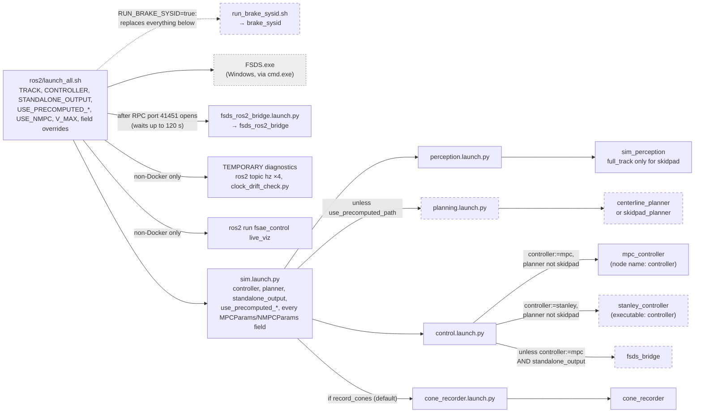

**Defaults differ by entry point.** Read the layer that launches the run.

| argument | `control.launch.py` alone | `sim.launch.py` | `launch_all.sh` (current) |
|---|---|---|---|
| `controller` | `stanley` | `mpc` | `mpc` |
| `standalone_output` | forwarded | `true` | `true` |
| `use_precomputed_path` / `_speed` | `true` / `true` | `true` / `true` | `true` / `true` |
| `use_nmpc` | dataclass `false` | dataclass `false` | `true` |
| `v_max` | YAML | `15.0` | `20.0` |
| `record_cones`, `log_csv` | n/a, `true` | `true`, `true` | not overridden |

- **Parameter precedence, highest first:** explicit launch argument, then the `MPCParams`/`NMPCParams` dataclass default, then `fsae_params.yaml`. The launch files forward every dataclass field as an argument after loading the YAML, so a YAML-only edit to a dataclass field never reaches the node. `python3 -m tuner.tools.param_report` shows which value wins for each field.
- **`launch_all.sh` pins the track** (`TRACK=comp_test_map_3`). Comment the line out to follow the newest recording. See [integration_guide.md](integration_guide.md#4-switching-the-track-the-car-drives).
- **The skidpad planner drives the car itself.** With `planner:=skidpad_planner` no controller is started, `fsds_bridge` runs, and `sim_perception` publishes the whole track (`full_track`).

---

## 4. Inside each node: one flowchart per module

Ordered by the data flow: perception, planning, the controller node, its speed target, the two solvers, then the command converter, the alternative controller and the logging. Every chart names the functions it summarises, so the source can be opened at the right place.

### 4.1 `sim_perception` hides the cones the car could not yet see

**Plain version.** FSDS hands out the whole cone map at once, which no real sensor could. This node keeps the full map private and republishes only the cones within sight, in the message types the car's own stack uses. It passes the car's true pose through untouched: no noise, no drift, no lag.

File: `perception/fsae_sim_perception/fsae_sim_perception/sim_perception.py`.

Mermaid source (edit this, then run <code>python3 -m tuner.tools.render_diagrams</code>)

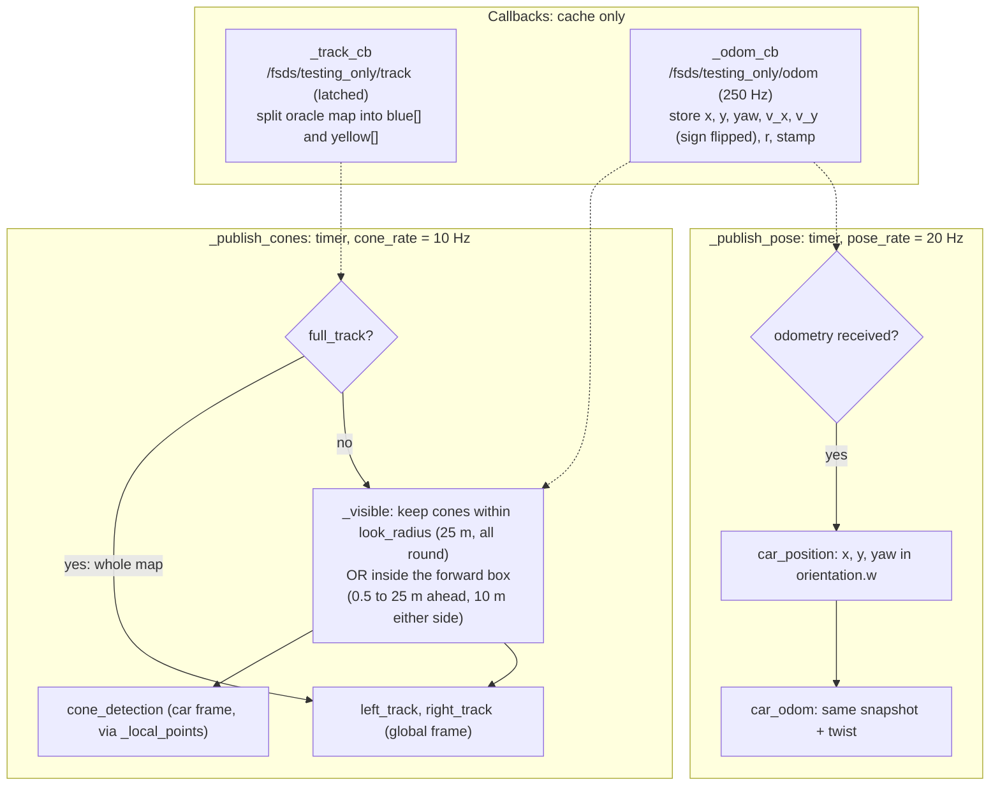

- **Why two timers.** Pose must be published at least as fast as the controller ticks (20 Hz), or the controller solves twice against one pose and over-corrects when the next arrives. Cropping cones and building three messages is the expensive part and the planner gains nothing from it at 20 Hz.
- **Why `car_odom` exists.** The controller needs pose and speed from the same instant. Two separate subscriptions to the 250 Hz raw topic could hold samples from different instants at one tick, which produced small throttle and brake oscillation in corners.
- **Offline twin:** `sim/perception.py` `SimPerception`, which has the forward box but not the all-round radius. See [architecture.md](../reference/architecture.md#perception-and-planning-can-be-simulated).

### 4.2 `centerline_planner` rebuilds the centre line on every pose

**Plain version.** Each time a new pose arrives, the planner adds any newly seen cones to its memory, joins same-coloured cones into walls, picks a chain of midpoints between the walls that never crosses one, smooths it, and blends it with the previous line so the path does not jump. It only runs when `use_precomputed_path:=false`.

File: `planning/fsae_planning/fsae_planning/centerline_planner.py`, helpers in `boundary.py`, `cone_map.py`, `path_utils.py`, `cone_sorting.py`.

Mermaid source (edit this, then run <code>python3 -m tuner.tools.render_diagrams</code>)

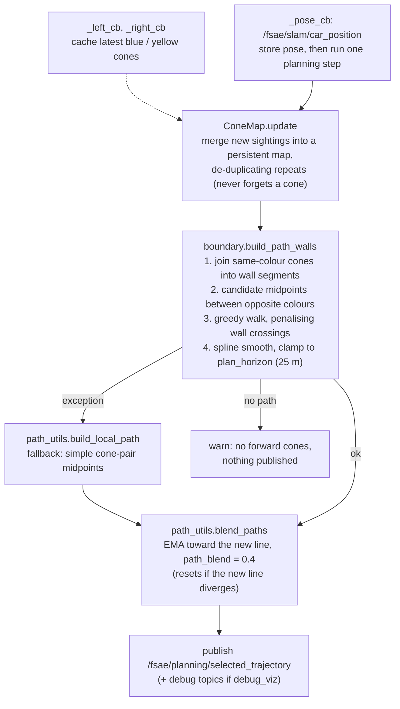

- **No localisation of its own.** The planner trusts `car_position` and re-plans from the cones it holds, lap after lap.
- **Known defect:** the centre line has curvature spikes. The controller carries workarounds for them. Read [simulator_fidelity.md](../reference/simulator_fidelity.md) before changing anything here.
- **Offline twin:** `sim/planner.py` `SimPlanner` over the same algorithms in `planning/`.

### 4.3 `mpc_controller` caches inputs and does all work on a 20 Hz timer

**Plain version.** Message callbacks only store the latest value. A fixed 20 Hz timer then decides, in order: wait for the start signal, brake if the path or pose is missing, work out a speed target, run the solver, override with a brake if a cone is right in front, log, and publish. The same node runs either solver, picked once at startup.

Files: `control/fsae_control/fsae_control/mpc/mpc_controller.py` (setup and callbacks), `mpc/control_step.py` (`_control_step`, the timer body), `mpc/debug_publish.py` (lap scoring and debug topics), constants in `mpc/node_constants.py`.

**Startup, once.**

Mermaid source (edit this, then run <code>python3 -m tuner.tools.render_diagrams</code>)

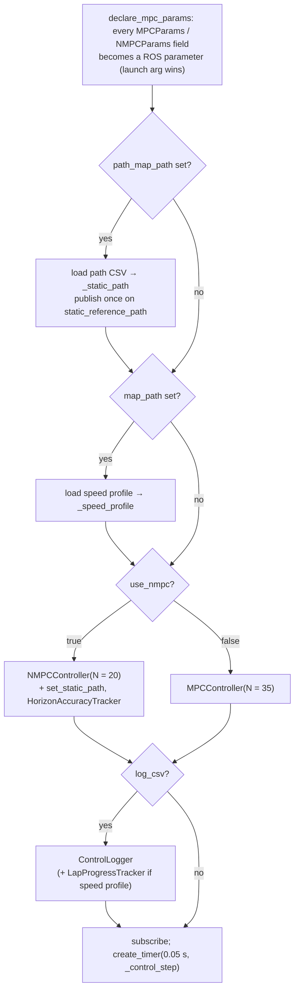

**Every tick (`_control_step`).**

Mermaid source (edit this, then run <code>python3 -m tuner.tools.render_diagrams</code>)

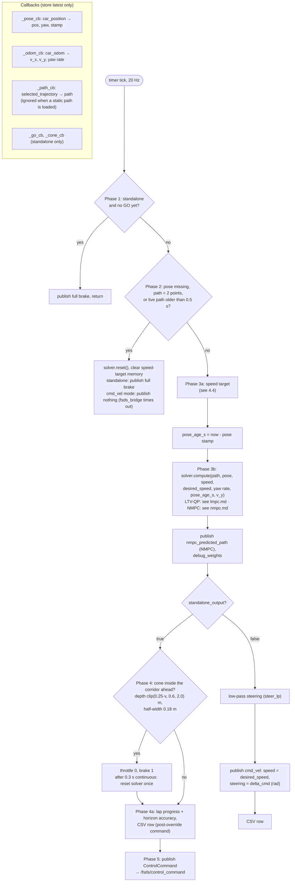

- **Why reset on a lost path.** The solver warm-starts from its last plan and remembers recent commands for delay compensation. Resuming from that state after a gap would steer from a stale plan.
- **Why `pose_age_s` is passed in.** The solver rolls the measured state forward by the commands sent since that pose was measured. A stale pose pins this compensation at its cap, which is how the periodic transport stall leads to a spin-out (see [quirk 7](#quirks-the-diagrams-encode)).
- **Output conversion.** Both solvers return `(steering, throttle, brake)` already in FSDS units: steering is `-delta_cmd / 25°` clipped to `[-1, 1]` (the sign flips because FSDS uses +1 = right), throttle is `a_cmd / a_max` for positive `a_cmd`, otherwise brake is `-a_cmd / a_max_brake`.
- **Offline twin:** `sim/rollout/core.py` `run_core_rollout()`, with the speed target in `sim/rollout/speed_target.py`.

### 4.4 The speed target is built in six steps before every solve

**Plain version.** The solver is told one target speed per tick and plans throttle and braking to track it. The target starts from the track's precomputed profile (or the curvature of the live path), is lowered when the car is already off line, may only rise gently, may not run too far ahead of the car's real speed, and drops toward zero near the end of an open path. None of this is a hard limit inside the solver. It only changes the speed the cost function asks for.

Code: the Phase 3 block of `_control_step` in `mpc/control_step.py`, helpers in `control_utils.py`, rates in `mpc/node_constants.py`.


Mermaid source (edit this, then run <code>python3 -m tuner.tools.render_diagrams</code>)

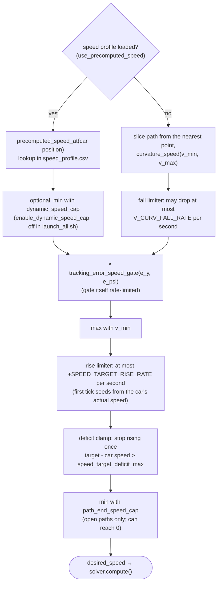

- The gate reads the previous tick's `e_y` and `e_psi` from the solver's telemetry, so it reacts one tick late by design.
- The end-of-path cap is why live-planner runs are slower: the planner's path always ends about 25 m ahead. See [control_mechanisms.md](../reference/control_mechanisms.md).
- Both solvers then low-pass the target once more inside `compute()` before using it.

### 4.5 The two solvers behind `compute()`

`mpc_controller` calls the same `compute()` on whichever solver it built. Their internal flow is drawn where their maths is explained:

| solver | built when | horizon | one `compute()` call | flowchart |
|---|---|---|---|---|
| LTV-QP, `lmpc.controller.MPCController` | `use_nmpc:=false` | N = 35, 1.75 s | error state, delay roll-forward, gain schedule, one convex QP (OSQP, Clarabel fallback) | [lmpc.md: what one live `compute()` call does](../controllers/lmpc.md#what-one-live-compute-call-does) |
| NMPC, `nmpc.solver.NMPCController` | `use_nmpc:=true` (current `launch_all.sh`) | N = 20, 1.0 s | Frenet state, nonlinear roll-forward, warm start, one Gauss-Newton SQP step with line search | [nmpc.md: what one live `compute()` call does](../controllers/nmpc.md#what-one-live-compute-call-does) |

### 4.6 `fsds_bridge` turns `cmd_vel` into pedal and steering commands

**Plain version.** In `cmd_vel` mode the controller only says "this fast, this much steering". This node supplies the pedals: more throttle the further below the target speed the car is, more brake the further above. It also holds the brake until the start signal, brakes if commands stop arriving, and brakes hard if a cone is right in front.

File: `control/fsae_control/fsae_control/fsds_bridge.py`. Not launched in the default standalone mode.

Mermaid source (edit this, then run <code>python3 -m tuner.tools.render_diagrams</code>)

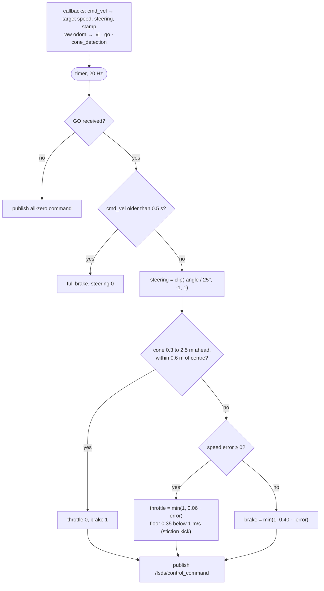

- **This P-loop replaces the MPC's own acceleration plan**, which is why offline-tuned longitudinal behaviour does not transfer in this mode.
- Its cone corridor (2.5 m by 0.6 m half-width) is wider than the standalone controller's (up to 2.0 m by 0.18 m), so the two modes brake for cones differently.

### 4.7 `stanley_controller` is the reactive baseline

**Plain version.** Stanley steers from the error right now (heading error plus a cross-track term, minus a yaw-rate damper) with no prediction. It runs once per pose message instead of on a timer and uses the same speed-target sources and safeguards as the MPC node.

File: `control/fsae_control/fsae_control/stanley/stanley_controller.py`, steering law in `control_utils.StanleyController`. Steering law flowchart: [stanley.md](../controllers/stanley.md#the-steering-law).

Mermaid source (edit this, then run <code>python3 -m tuner.tools.render_diagrams</code>)

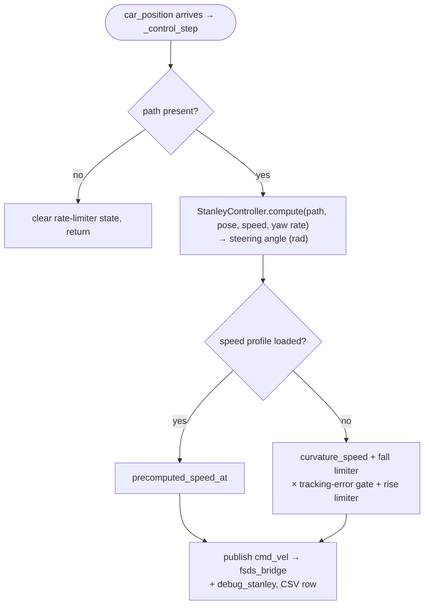

- Reads speed and yaw rate from the raw `/fsds/testing_only/odom`, not `car_odom`.
- Always uses the `cmd_vel` path, so `fsds_bridge` always runs with Stanley.

### 4.8 Telemetry and `live_viz` watch the loop without touching it

**Plain version.** Two things record a run. The controller writes a CSV row every tick, with the errors only it can compute, and scores each lap with the same formula as the offline tuner. `live_viz` is a separate matplotlib window that subscribes to the same topics and draws the car, cones, reference, the NMPC's prediction and live cost breakdowns. Neither feeds back into control.

Files: `telemetry/` (`control_logger.py`, `lap_progress.py`, `horizon_tracker.py`, `scoring.py`, `columns.py`), `live_viz/` (`node.py`, `app.py`, `panels.py`).

Mermaid source (edit this, then run <code>python3 -m tuner.tools.render_diagrams</code>)

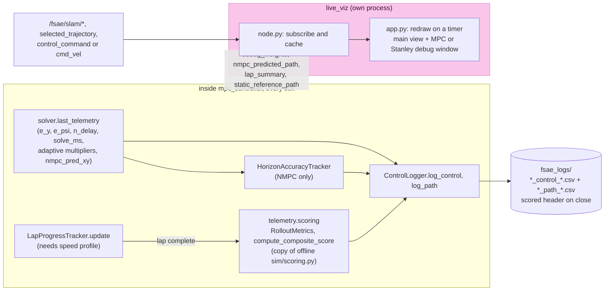

- **The CSV is the only place `e_y` and `e_psi` exist.** They are computed inside the solver and never published, so a rosbag cannot replace it.
- **Scores are comparable with offline scores** because `telemetry/scoring.py` is a copy of `sim/scoring.py`. A live-planner run has no known path end and is logged as `score_is_partial=1`. See [offline_live_parity.md](../reference/offline_live_parity.md).
- `fsae_logs/` has no retention policy and grows without bound.

### 4.9 `cone_recorder` writes one lap of cones to a track file

**Plain version.** During a live-planner run this node collects every cone the car sees and, once the car returns to its start point, writes them to `cone_map.json`. That file is the input for building a new track's precomputed path and speed profile offline.

File: `perception/fsae_sim_perception/fsae_sim_perception/cone_recorder.py`.

Mermaid source (edit this, then run <code>python3 -m tuner.tools.render_diagrams</code>)

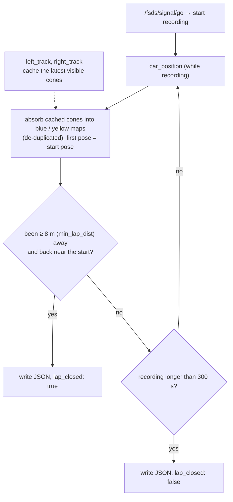

Recording only captures something useful with the live planner in the loop (`use_precomputed_path:=false`), because only then is the car driving off what it sees. The full record, export and drive workflow is in [integration_guide.md](integration_guide.md#recording-exporting-and-driving-a-track).

---

## Quirks the diagrams encode

1. **Yaw travels in `orientation.w`.** `car_position` is a `PoseStamped` whose `orientation.w` holds yaw in radians, not a quaternion. `car_odom` uses a real quaternion. This matches the convention of the car's own stack.
2. **Nothing arbitrates `/fsds/control_command`.** Correctness depends on launching exactly one publisher. `control.launch.py` enforces it for the controller and `fsds_bridge`. Starting `brake_sysid` or a second stack by hand breaks it.
3. **In precomputed-path mode no node publishes the path.** The controller reads the CSV, ignores `selected_trajectory`, never treats its path as stale, and publishes the path once on `static_reference_path` for the viewer only. A lost pose still triggers the Phase 2 brake.
4. **Both controllers are the node `/controller`.** `ros2 node info /controller` works for either. The startup log shows which solver was built: a `use_nmpc=True: running the NONLINEAR MPC` warning for the NMPC, and `MPC controller ready [<output mode>]` for the output mode.
5. **The MPC and the other nodes read speed from different topics.** `mpc_controller` reads `car_odom` (20 Hz, published with the pose from the same sample). Stanley, `fsds_bridge` and `skidpad_planner` read the raw 250 Hz odometry.
6. **The pose is ground truth.** `sim_perception` copies FSDS's true pose with no noise, drift or estimation lag. Only the cone visibility is realistic.
7. **A transport stall sits upstream of everything.** Odometry, `/clock` and IMU stall together on a period of about 31.7 to 34 s. The stall inflates `pose_age_s`, pins the solver's delay compensation at its cap, and has caused a spin-out at the tightest corner. The layer it lives in is unidentified. See [periodic_pose_teleport_investigation.md](../logs/periodic_pose_teleport_investigation.md).
8. **After a spin the car can sit still indefinitely.** A standstill deadlock was observed after the stall-induced spin and is not yet investigated.
